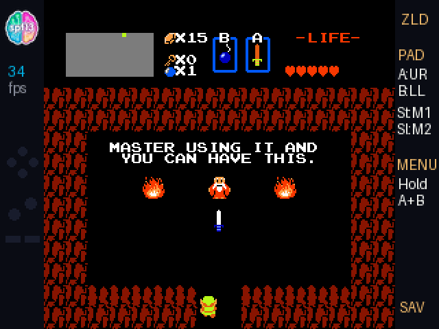
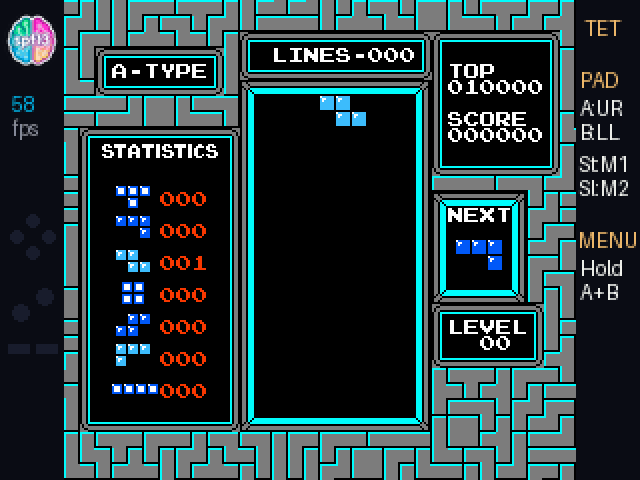
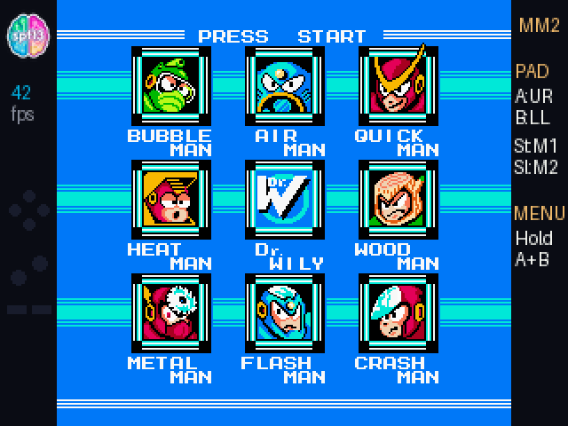
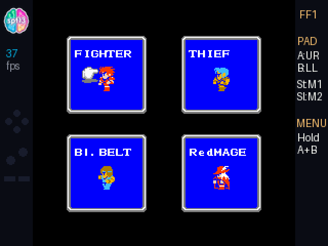
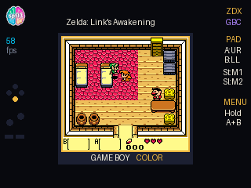
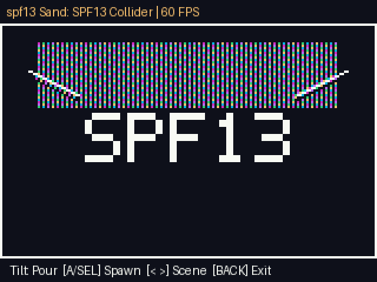

# GitHub Universe 2026 Badge Hacks (`spf13 labs`)

Custom apps, hardware showcases, and pure-`@micropython.viper` **NES** and **Game Boy Color** emulators written from scratch (in collaboration with **Gemini 4 Argon**) for the **GitHub Universe 2026 ARM Hackable Badge ("Badger")** powered by the dual-core **RP2350** (`Cortex-M33`) running **MonaOS 4.0**.

Read the full engineering breakdown on **[spf13.com](https://spf13.com)**:
1. **[Inside the GitHub Universe 2026 Badge: Dual-Core 3D, IMU Physics, and Open Hardware](https://spf13.com/post/hacking-the-github-universe-2026-badge/)**
2. **[Writing NES & Game Boy Color Emulators from Scratch for the GitHub Universe Badge in MicroPython Viper](https://spf13.com/post/putting-zelda-on-the-github-universe-badge/)**



| *Tetris* (58 FPS on RP2350) | *Mega Man 2* (Crash Man Stage) |
| :---: | :---: |
|  |  |

| *Final Fantasy* (NES — MMC1 + Battery Save) | *Game Boy Color* (*Link's Awakening DX*, *Pokémon Crystal*, *Super Mario Land*) |
| :---: | :---: |
|  |  |



---

## What's Inside

### 1. `apps/nes` — 300 MHz `@micropython.viper` NES Emulator (Written from Scratch)
A full 6502 CPU, PPU scanline renderer, and Mapper 0 (`NROM`), Mapper 1 (`MMC1`), Mapper 2 (`UxROM`), and Mapper 3 (`CNROM`) emulator written from scratch in ARM Thumb-2 native `@micropython.viper` code (`1,100` lines of pure Python/Viper — no C firmware flashing required).
- **Zero-Allocation Flat Memory Block**: Packs CPU RAM, PPU VRAM, OAM, palettes, and 512-entry CHR tile cache into a single contiguous `bytearray` indexed via `ptr8` / `ptr16` pointers.
- **RPG & Action Classics Ready**: Pre-configured profiles for *The Legend of Zelda*, *Final Fantasy*, *Dragon Warrior*, *Super Mario Bros.*, *Tetris*, *Contra*, *Castlevania*, *Mega Man 2*, *Metroid*, and more.
- **Upside-Down Gamepad Auto-Rotation**: Uses `badge.autorotate(True)` and maps the top capacitive gamepad (`badge.pad`) so you can flip the badge upside-down and play like a real handheld console.
- **Automatic Full Save States**: Saves full CPU + PPU + RAM + Mapper state to `/state/nes_<rom>.state` on pause, idle, or when pressing the physical `HOME` button.

### 2. `apps/gbc` — 300 MHz `@micropython.viper` Game Boy & Game Boy Color Emulator (Written from Scratch)
A complete Sharp SM83 (`LR35902`) CPU, 15-bit BGR555 Game Boy Color & DMG PPU scanline renderer (`1.5×` `240×216` fullscreen upscale + `1:1` `160×144` native mode), and `ROM`/`MBC1`/`MBC2`/`MBC3`/`MBC5` cartridge mapper with an O(1) demand-paged 16 KB bank cache supporting up to **2 MB – 4 MB Game Boy Color ROMs** (*The Legend of Zelda: Link's Awakening DX*, *Oracle of Ages*, *Oracle of Seasons*, *Pokémon Crystal*, *Dragon Warrior I & II*, *Tetris DX*, *Super Mario Land*).

### 3. `apps/hacker` — `spf13 labs` Hardware Lab & Physics Playground
A 3-tab hardware showcase pushing the RP2350, `pico3d`, and `LSM6DS3` 6-axis IMU:
- **Tab 1 — 60 FPS IMU Neon Sand Physics Toy (`sand_and_3d.py`)**: Cellular automata falling-sand engine (`4,000` neon particles) running at ~70 FPS (`14.2 ms/frame`) in `@micropython.viper` with 360-degree accelerometer gravity, shake vortex explosions, and 4 obstacle scenes (`SPF13 Collider`, `Hourglass`, `Plinko Pegs`, and `Open Basin`).
- **Tab 2 — Dual-Core `pico3d` 3D Mesh Showcase (`spf13_logo.p3d`)**: Custom `P3DM` v1 binary mesh rendered across both RP2350 cores by `pico3d` with real-time `LSM6DS3` 6-axis IMU tilt tracking, plus instant switching into the 4,000–20,000 triangle Mona LOD meshes.
- **Tab 3 — Live Hardware & IMU Telemetry**: Real-time 6-axis accelerometer/gyroscope readout, RP2350 clock & MicroPython heap inspector, and IMU-reactive ambient case LEDs.

### 3. `apps/badge` — Custom Digital Badge & Scannable `168×168` QR Code
Upgrades the stock digital badge with high-contrast `168×168` QR code rendering, offline GitHub stats/contribution graph fallback (`badge_user.json` / `badge_contribs.json`), and custom branding views.

---

## 2-Minute Installation Guide

### Step 1: Mount Your Badge in USB Disk Mode
1. Plug your GitHub Universe 2026 badge into your computer via USB-C.
2. On the badge home menu, scroll to and launch the **USB Disk** (`mass_storage`) app.
3. Your badge will mount on your computer as a removable USB drive (e.g., `F:\` on Windows or `/Volumes/BADGER` on macOS).

### Step 2: Copy the Apps to Your Badge
Clone this repository and copy the `apps/` folders onto the badge drive:

```powershell
# Clone the repo
git clone https://github.com/spf13/universe-2026-badge-hacks.git
cd universe-2026-badge-hacks

# Copy NES Emulator, Game Boy Color Emulator, and Hardware Lab to your badge (assuming drive F:)
Copy-Item -Recurse -Force .\apps\nes F:\apps\
Copy-Item -Recurse -Force .\apps\gbc F:\apps\
Copy-Item -Recurse -Force .\apps\hacker F:\apps\
```

*(Optional)* If you also want the upgraded `168×168` QR Code Badge app, copy `.\apps\badge` to `F:\apps\badge` and copy `secrets.example.py` to `F:\secrets.py` with your GitHub handle and LinkedIn URL.

### Step 3: Add Your `.nes`, `.gb`, and `.gbc` ROMs (Bring Your Own ROMs)
Copy your `.nes` ROM files into `F:\apps\nes\roms\` and your `.gb` / `.gbc` ROM files into `F:\apps\gbc\roms\`:

```powershell
Copy-Item C:\path\to\your\roms\*.nes F:\apps\nes\roms\
Copy-Item C:\path\to\your\roms\*.gb* F:\apps\gbc\roms\
```

The launchers automatically discover every `.nes`, `.gb`, and `.gbc` file in their `roms/` folders!

### Step 4: Eject & Play!
Safely eject the USB drive from your OS. The badge will reboot into **MonaOS** with **NES** and **Hacker** right on your home launcher!

---

## Controls Reference

### NES Emulator (`apps/nes`)
Flip the badge **upside-down** so the capacitive gamepad sits at the bottom under your thumbs — the screen automatically rotates 180 degrees!
- **D-Pad (`^` `v` `<` `>`)**: Move / Navigate ROM list
- **`A` / `B` (Right action pads)**: NES `A` and `B` buttons
- **Right Middle Touch Pad (`HOME` pad)**: `START`
- **Left Middle Touch Pad (`MENU` pad)**: `SELECT`
- **Hold `A + B` (or Hold `START + SELECT`) for 0.6s**: Open **In-Game Pause Menu** (Save State, Frame Skip, CRT Scanlines, Reset Console, Exit to ROM List)
- **Physical `HOME` Button (back of badge)**: Immediately saves your state to `/state/nes_<rom>.state` and exits to MonaOS

### IMU Neon Sand Physics Toy (`apps/hacker`)
- **Tilt Badge**: Pour neon sand in 360 degrees across obstacle scenes
- **`<` / `>` (or Bottom-Right button)**: Cycle obstacle scenes (`SPF13 Collider` -> `Hourglass` -> `Plinko Pegs` -> `Open Basin`)
- **`A` / `SELECT` / `DOWN`**: Spawn a 450-particle neon burst
- **Shake Badge**: Trigger vortex explosion
- **`BACK` (or Bottom-Left button)**: Return to menu

### Compile Your Own 3D `.p3d` Mesh
Want your own handle or logo spinning in 3D on the badge? Run `tools/generate_p3d.py`:

```bash
python tools/generate_p3d.py --text "SPF13" --out apps/hacker/spf13_logo.p3d
```

---

## License
MIT © [Steve Francia (spf13)](https://spf13.com)
